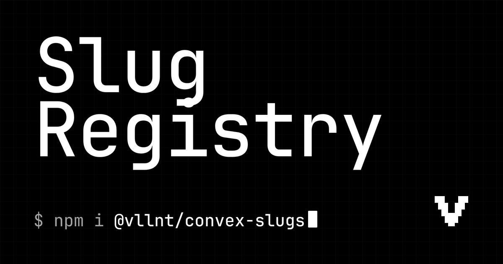

# @vllnt/convex-slugs

Convex component for unique slugs, handles and usernames per scope, with rename redirects, a TypeScript client and React hooks.



## For coding agents

Docs for the installed version are in `node_modules/@vllnt/convex-slugs/`:
`docs/API.md`, `llms.txt`, `CHANGELOG.md` and the TypeScript `src/`. Read them
before writing code against this package.

## When to use

- Use it when each public name (article slug, `@handle`, username, workspace
  slug) must be unique inside a scope, even under concurrent claims.
- Use it when renaming must keep old URLs working through a redirect.
- Use it when you need lookups both ways: slug to resource and resource to slug.
- Do not use it when the key must stay secret (share links, magic links,
  invites): a slug is meant to be public (it appears in URLs). Use
  [`@vllnt/convex-tokens`](https://oss.vllnt.com/packages/convex-tokens).

## Install

```bash
pnpm add @vllnt/convex-slugs
```

## Quick start

```ts
// convex/convex.config.ts
import slugs from "@vllnt/convex-slugs/convex.config";
import { defineApp } from "convex/server";

const app = defineApp();
app.use(slugs);
export default app;
```

```ts
// convex/handles.ts
import { Slugs } from "@vllnt/convex-slugs";
import { ConvexError, v } from "convex/values";

import { components } from "./_generated/api";
import { mutation, query } from "./_generated/server";

const slugs = new Slugs(components.slugs);

export const claim = mutation({
  args: { handle: v.string() },
  returns: v.object({ ok: v.boolean(), reason: v.optional(v.string()) }),
  handler: async (ctx, { handle }) => {
    const user = await ctx.auth.getUserIdentity();
    if (user === null) throw new ConvexError("not signed in");
    return slugs.reserve(ctx, handle, user.subject);
  },
});

export const lookup = query({
  args: { slug: v.string() },
  returns: v.union(v.string(), v.null()),
  handler: (ctx, { slug }) => slugs.resolve(ctx, slug),
});
```

Run `npx convex dev` once to generate `components.slugs`. The component never
reads auth: the host picks the `resourceRef` (here the user's `subject`) and
decides who may claim, rename or release a slug. `lookup` is a public query, so
every caller sees the `resourceRef` it returns; see [Security](#security).

## API

Full reference: [docs/API.md](docs/API.md).

| Export                                                                     | Import from                                | What it does                                                                                                    |
| -------------------------------------------------------------------------- | ------------------------------------------ | --------------------------------------------------------------------------------------------------------------- |
| [`Slugs`](docs/API.md#slugs)                                               | `@vllnt/convex-slugs`                      | Host client: `new Slugs(components.slugs, options?)`                                                            |
| [`reserve(ctx, slug, resourceRef, scope?)`](docs/API.md#reserve)           | `Slugs` method, mutation                   | Claim a free slug; returns `{ ok, reason? }`                                                                    |
| [`release(ctx, slug, scope?)`](docs/API.md#release)                        | `Slugs` method, mutation                   | Free a slug and the redirects pointing at it; returns `null`                                                    |
| [`rename(ctx, fromSlug, toSlug, scope?)`](docs/API.md#rename)              | `Slugs` method, mutation                   | Move a held slug and record `fromSlug` -> `toSlug`                                                              |
| [`resolve(ctx, slug, scope?)`](docs/API.md#resolve)                        | `Slugs` method, query                      | The `resourceRef` holding `slug`, or `null`                                                                     |
| [`redirectFor(ctx, slug, scope?)`](docs/API.md#redirectfor)                | `Slugs` method, query                      | The live slug a renamed-away `slug` points to, or `null`                                                        |
| [`slugForResource(ctx, resourceRef, scope?)`](docs/API.md#slugforresource) | `Slugs` method, query                      | The slug held by `resourceRef`, or `null`                                                                       |
| [`SlugsComponent`](docs/API.md#slugscomponent)                             | `@vllnt/convex-slugs` (type)               | Type of `components.slugs`                                                                                      |
| [`SlugsOptions`](docs/API.md#slugsoptions)                                 | `@vllnt/convex-slugs` (type)               | `{ defaultScope?, foldCase?, minLength?, maxLength?, pattern?, reservedWords? }`                                |
| [`SlugWriteResult`](docs/API.md#slugwriteresult)                           | `@vllnt/convex-slugs` (type)               | Result of `reserve` and `rename`                                                                                |
| [`useSlugAvailable`](docs/API.md#useslugavailable)                         | `@vllnt/convex-slugs/react`                | `useSlugAvailable(lookupRef, { slug, scope? })`: live "is it free?"; pass `scope` only if your query accepts it |
| [`useResolve`](docs/API.md#useresolve)                                     | `@vllnt/convex-slugs/react`                | `useResolve(lookupRef, { slug, scope? })`: live holder or `null`; pass `scope` only if your query accepts it    |
| [`default` (component config)](docs/API.md#convexconfig)                   | `@vllnt/convex-slugs/convex.config`        | Pass to `app.use(...)`                                                                                          |
| [`register`](docs/API.md#register)                                         | `@vllnt/convex-slugs/test`                 | `register(t, name?)`: mount the component in `convex-test`                                                      |
| [`ComponentApi`](docs/API.md#componentapi)                                 | `@vllnt/convex-slugs/_generated/component` | Generated type of the mounted component                                                                         |

## Common tasks

Rename the signed-in user's handle, then serve old URLs with a redirect:

```ts
// convex/profiles.ts
import { Slugs } from "@vllnt/convex-slugs";
import { ConvexError, v } from "convex/values";

import { components } from "./_generated/api";
import { mutation, query } from "./_generated/server";

const slugs = new Slugs(components.slugs);

export const changeHandle = mutation({
  args: { handle: v.string() },
  returns: v.object({ ok: v.boolean(), reason: v.optional(v.string()) }),
  handler: async (ctx, { handle }) => {
    const user = await ctx.auth.getUserIdentity();
    if (user === null) throw new ConvexError("not signed in");
    const current = await slugs.slugForResource(ctx, user.subject);
    if (current === null) return slugs.reserve(ctx, handle, user.subject);
    return slugs.rename(ctx, current, handle);
  },
});

export const profileBySlug = query({
  args: { slug: v.string() },
  returns: v.union(
    v.object({ resourceRef: v.string() }),
    v.object({ redirectTo: v.string() }),
    v.null(),
  ),
  handler: async (ctx, { slug }) => {
    const resourceRef = await slugs.resolve(ctx, slug);
    if (resourceRef !== null) return { resourceRef };
    const redirectTo = await slugs.redirectFor(ctx, slug);
    return redirectTo === null ? null : { redirectTo };
  },
});
```

Give each workspace its own article slugs, with a charset, a length cap and
reserved words. Call this from host code that has already checked the caller
may publish in the workspace:

```ts
// convex/articles.ts
import { Slugs } from "@vllnt/convex-slugs";
import { v } from "convex/values";

import { components } from "./_generated/api";
import { internalMutation } from "./_generated/server";

const articles = new Slugs(components.slugs, {
  defaultScope: "articles",
  maxLength: 80,
  pattern: /^[a-z0-9]+(?:-[a-z0-9]+)*$/,
  reservedWords: ["new", "edit", "settings"],
});

export const publish = internalMutation({
  args: { workspaceId: v.string(), articleId: v.string(), slug: v.string() },
  returns: v.object({ ok: v.boolean(), reason: v.optional(v.string()) }),
  handler: (ctx, { workspaceId, articleId, slug }) =>
    articles.reserve(ctx, slug, articleId, `articles:${workspaceId}`),
});

export const unpublish = internalMutation({
  args: { workspaceId: v.string(), slug: v.string() },
  returns: v.null(),
  handler: (ctx, { workspaceId, slug }) =>
    articles.release(ctx, slug, `articles:${workspaceId}`),
});
```

Show whether a handle is free while the user types. The hook takes your own
public query that returns `string | null`, here `lookup` from the Quick start:

```tsx
// src/HandleField.tsx
import { useSlugAvailable } from "@vllnt/convex-slugs/react";
import { useState } from "react";

import { api } from "../convex/_generated/api";

export function HandleField() {
  const [handle, setHandle] = useState("");
  const { available } = useSlugAvailable(api.handles.lookup, { slug: handle });
  return (
    <label>
      Handle
      <input
        value={handle}
        onChange={(event) => {
          setHandle(event.target.value);
        }}
      />
      {available === false ? " is taken" : null}
    </label>
  );
}
```

## Errors and fixes

`reserve` and `rename` do not throw for expected rejections. They return
`{ ok: false, reason }`:

| `reason`         | Cause                                                                                                                                  | Fix                                                                                          |
| ---------------- | -------------------------------------------------------------------------------------------------------------------------------------- | -------------------------------------------------------------------------------------------- |
| `SLUG_INVALID`   | After normalization the slug is empty, outside `minLength`..`maxLength`, fails `pattern`, or is over the component's cap of 1024 UTF-16 code units (`string.length`) | Show the rule to the user; for `rename` only `toSlug` is checked. Keep `maxLength` at 1024 or less so the client rule matches the cap |
| `SLUG_RESERVED`  | The normalized slug is in `reservedWords`                                                                                              | Ask for another slug                                                                         |
| `SLUG_TAKEN`     | The slug is held in the scope (by anyone, including the same `resourceRef`), or `rename` got `fromSlug === toSlug` after normalization | Ask for another slug; for `rename`, skip the call when both names normalize to the same slug |
| `SLUG_NOT_FOUND` | `rename` got a `fromSlug` that is not held in the scope                                                                                | Read the current slug with `slugForResource` and rename that one                             |

Invalid input throws a `ConvexError` whose `data` is `{ code, message }`; the
host sees the code as `error.data.code`. `reserve` and `rename` check the slug in
the client first, so a slug that fails those checks returns `SLUG_INVALID` (or
`SLUG_RESERVED`) before the component sees an empty scope.

| Code               | Message                                                                                                                                       | Cause                                                                                                                                                                                | Fix                                                                                                                  |
| ------------------ | --------------------------------------------------------------------------------------------------------------------------------------------- | ------------------------------------------------------------------------------------------------------------------------------------------------------------------------------------ | -------------------------------------------------------------------------------------------------------------------- |
| `INVALID_OPTIONS`  | `Slugs options: defaultScope must be non-empty; minLength and maxLength must be integers with 0 <= minLength <= maxLength and maxLength >= 1` | `new Slugs(...)` got an empty `defaultScope`, a non-integer or negative `minLength`, a non-integer `maxLength`, or `maxLength` below `max(1, minLength)`                             | Fix the options. A `new Slugs` at module top level throws when Convex loads that file, so every function in it fails |
| `INVALID_ARGUMENT` | `scope and resourceRef must be non-empty, and at most 1024 UTF-16 code units on reserve and rename; bounds must be integers with min <= max` | `reserve`, `release` or `rename` got `scope: ""`, or `reserve` got `resourceRef: ""`; `reserve` or `rename` got a `scope`, or `reserve` a `resourceRef`, over 1024 UTF-16 code units; or a direct component call passed `bounds` that are not integers with `minLength <= maxLength` | Pass a non-empty scope (or omit it for `defaultScope`) and a non-empty `resourceRef`, each at most 1024 UTF-16 code units |

Arguments of the wrong type are rejected by Convex argument validation before
the component runs.

## Limits and gotchas

- Slugs are normalized before every write and lookup: Unicode NFC, then
  `trim()`, then `toLowerCase()` unless `foldCase: false`. `" Ada "` and `"ada"`
  are the same slug by default. NFC does not merge look-alike characters from
  different scripts, compatibility forms (NFKC) or zero-width characters; use
  `pattern` to restrict the alphabet.
- `minLength` and `maxLength` count UTF-16 code units of the normalized slug
  (a single emoji such as 😀 counts 2; flags and joined emoji count more).
  Defaults: `minLength: 1`, `maxLength: 256`,
  `defaultScope: "global"`, `foldCase: true`, `reservedWords: []`, no
  `pattern`. An empty slug is always `SLUG_INVALID`, even with `minLength: 0`.
- The component caps what `reserve` and `rename` write at 1024 UTF-16 code
  units (`string.length`, counted like `maxLength`), whatever `maxLength` or
  `bounds` say: a longer slug returns `SLUG_INVALID`, and a longer `scope` or
  `resourceRef` throws `INVALID_ARGUMENT`. For example 512 😀 (1024 units)
  passes and 513 (1026 units) is rejected. `new Slugs` still accepts a
  `maxLength` over 1024, but slugs longer than 1024 are rejected by the
  component. `release` and the queries are not capped.
- Rows that a version before 0.2.0 stored with a slug, `scope` or
  `resourceRef` over 1024 units stay readable with `resolve`, `redirectFor`
  and `slugForResource`, and `release` removes them. `rename` from such a slug
  to a shorter one works and records the redirect; `reserve` or `rename` onto
  such a slug returns `SLUG_INVALID`; `reserve` and `rename` in such a scope
  throw `INVALID_ARGUMENT`. A row with a long `resourceRef` keeps it when
  renamed.
- `pattern` and `reservedWords` run against the normalized slug, so with
  `foldCase: true` a pattern of `/^[a-z]+$/` accepts `"ADA"`.
- `release` is idempotent and always returns `null`: releasing a slug that is
  not held does nothing and does not tell you so. It does not check who holds
  the slug.
- `reserve` does not limit one slug per `resourceRef`; one resource can hold
  several slugs, and `slugForResource` then returns one of them.
- Reserving a name that was renamed away deletes its redirect: old links stop
  redirecting and resolve to the new holder.
- `resolve` of an old name returns `null` after a rename. Call `redirectFor` to
  find the live slug, then `resolve` that. Redirect chains are collapsed, so
  one `redirectFor` call is enough.
- `useSlugAvailable` and `useResolve` are a hint. They do not check length,
  `pattern` or reserved words, an empty slug reads as available, and another
  user can claim the slug before `reserve` runs. Always check `reserve`'s
  result.
- Scopes are separate namespaces and are not checked against a list: a wrong
  scope returns `null` from every query. Changing `foldCase` or `defaultScope`
  later does not migrate stored rows.
- Rows that 0.1.0 stored under scope `""` can still be read with `resolve`,
  `redirectFor` and `slugForResource`, but `reserve`, `release` and `rename`
  reject `scope: ""` with `INVALID_ARGUMENT`.
- There is no list, search or history API. The component stores only the
  current holder of each slug and one redirect per old name.

## Compatibility

- Peer dependency: `convex@^1.45.0`. CI runs the unit tests on the locked convex
  version (1.51.0), and type-checks and runs the packed package against convex
  1.45.0.
- Node.js: convex 1.45 to 1.48 require Node.js 20 or later; convex 1.49 and
  newer require Node.js 22 or later. ES modules only.
- `Slugs` runs in Convex queries, mutations and actions: it only calls
  `ctx.runQuery` and `ctx.runMutation`.
- React: optional peer `react@>=18`, used only by `@vllnt/convex-slugs/react`.
  The hooks call `useQuery` from `convex/react`, so they need a
  `ConvexProvider` above them. The packed package is type-checked and imported
  with React 18.3.
- `@vllnt/convex-slugs/test` needs `convex-test`, `vitest`, `vite` and
  `@edge-runtime/vm`, with the Vitest config shown under Testing.

## Testing

Mount the component in your own `convex-test` suite with `register`. Use the
Vitest settings `convex-test` recommends (edge runtime, `convex-test` inlined):

```ts
// vitest.config.mts
import { defineConfig } from "vitest/config";

export default defineConfig({
  test: {
    environment: "edge-runtime",
    server: { deps: { inline: ["convex-test"] } },
  },
});
```

```ts
// convex/handles.test.ts
/// <reference types="vite/client" />
import { register } from "@vllnt/convex-slugs/test";
import { convexTest } from "convex-test";
import { expect, test } from "vitest";

import { api } from "./_generated/api";
import schema from "./schema";

test("a handle can be claimed once, in any case", async () => {
  const t = convexTest(schema, import.meta.glob("./**/*.ts"));
  register(t);
  const ada = t.withIdentity({ subject: "user-ada" });
  const bob = t.withIdentity({ subject: "user-bob" });
  expect(await ada.mutation(api.handles.claim, { handle: "Ada" })).toEqual({
    ok: true,
  });
  expect(await bob.mutation(api.handles.claim, { handle: "ADA" })).toEqual({
    ok: false,
    reason: "SLUG_TAKEN",
  });
  expect(await t.query(api.handles.lookup, { slug: "ada" })).toBe("user-ada");
});
```

`register(t, name)` takes the mount name when you used
`app.use(slugs, { name })`.

This repository's own tests run on the simulated `convex-test` runtime
(`pnpm test:coverage`, 100% coverage enforced), including concurrent claims of
one slug.

## Security

- The component does not authenticate. The host must authorize every call:
  check that the caller owns a slug before `rename` or `release`, and derive
  `resourceRef` and `scope` on the server; never accept them from the client.
- `resolve` returns the `resourceRef`. A public query that forwards it shows
  that value to every caller, so use refs you are willing to publish.
- Scopes are namespaces, not access control.
- The tables are reachable only through the component's functions, and those
  are callable only from the host's own functions. A host that calls
  `components.slugs` directly instead of through `Slugs` skips normalization,
  `pattern` and reserved words; the component then only rejects an empty slug
  and one outside the `bounds` the caller passes or over the 1024-unit cap.
- Each `reserve` and `rename` is one Convex mutation (serializable): of
  simultaneous claims on one slug, one succeeds and the others get
  `SLUG_TAKEN`.

Report vulnerabilities as described in
[SECURITY.md](https://github.com/vllnt/convex-slugs/blob/main/SECURITY.md).

## Related packages

None. This package has no dependency, shared test or example with another
package.

## Contributing

See
[CONTRIBUTING.md](https://github.com/vllnt/convex-slugs/blob/main/CONTRIBUTING.md).

## Links

- Docs and changelog: [oss.vllnt.com/packages/convex-slugs](https://oss.vllnt.com/packages/convex-slugs) · [release feed](https://oss.vllnt.com/packages/convex-slugs/rss.xml)
- All @vllnt packages: [oss.vllnt.com](https://oss.vllnt.com) · [search packages and docs on index.vllnt.com](https://index.vllnt.com)
- Source and issues: [GitHub](https://github.com/vllnt/convex-slugs) · [issues](https://github.com/vllnt/convex-slugs/issues) · [npm](https://www.npmjs.com/package/@vllnt/convex-slugs)
- Questions and updates: [Discord](https://bntvllnt.com/discord) · [X @bntvllnt](https://x.com/bntvllnt)
- Company and author: [vllnt.com](https://vllnt.com) · [bntvllnt.com](https://bntvllnt.com) · [GitHub @bntvllnt](https://github.com/bntvllnt) · [LinkedIn](https://linkedin.com/in/bntvllnt)
- Sponsor: [GitHub Sponsors](https://github.com/sponsors/bntvllnt)

## License

MIT. See [LICENSE](LICENSE).

[](https://www.npmjs.com/package/@vllnt/convex-slugs)
[](https://github.com/vllnt/convex-slugs/actions/workflows/ci.yml)

---

Part of [vllnt open source](https://oss.vllnt.com) · [Package page](https://oss.vllnt.com/packages/convex-slugs) · [vllnt.com](https://vllnt.com) · Built by [bntvllnt](https://bntvllnt.com)
